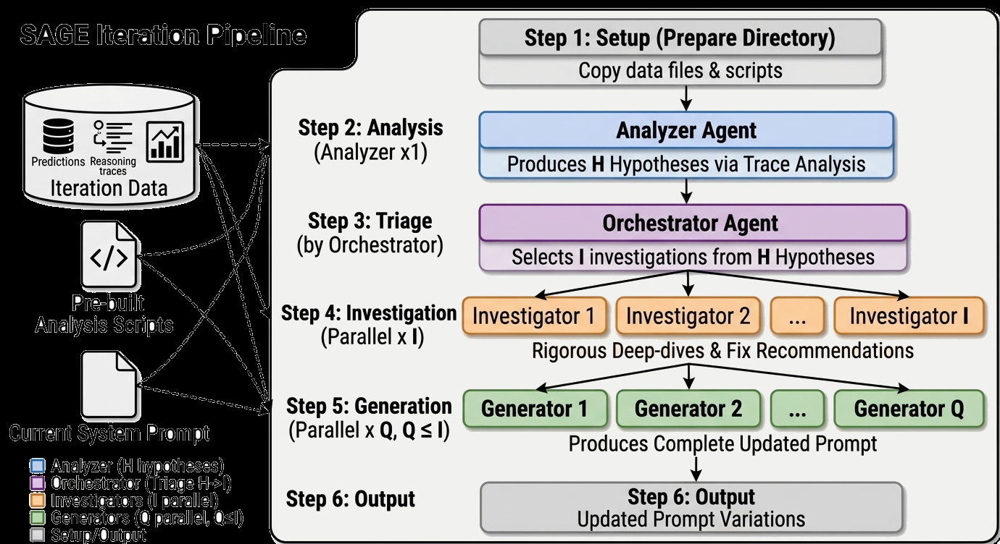

# SAGE: Stochastic Prompt Optimization via Agent-Guided Exploration

[](https://aclanthology.org/2026.emnlp-industry.221/)

Code for the EMNLP 2026 Industry Track paper:

> **SAGE: Stochastic Prompt Optimization via Agent-Guided Exploration**
> Ziyi Zhu, Luka Smyth, Saki Shinoda, Jinghong Chen
> *Proceedings of the 2026 Conference on Empirical Methods in Natural Language Processing: Industry Track*, pages 3695–3711.
> [[Paper]](https://aclanthology.org/2026.emnlp-industry.221/) [[PDF]](https://aclanthology.org/2026.emnlp-industry.221.pdf)

<p align="center">
  
</p>

## Abstract

Context engineering has emerged as a primary lever for improving AI systems without parameter updates. Recent work showing that textual gradients do not function as real gradients motivates treating automatic prompt optimization (APO) as black-box search. We introduce SPO (Stochastic Prompt Optimization), a framework for stochastic search over prompt space, and compare three strategies of increasing sophistication: error-informed random search, a genetic algorithm with evolutionary operators, and SAGE (SPO via Agent-Guided Exploration), a multi-agent pipeline with diagnostic code execution. Across three benchmarks, no single strategy dominates; effectiveness depends on the interaction of landscape structure with error type. We further deploy SAGE on a mental-health chatbot under a continuous optimization paradigm, where it compounds eight cycles of individually-noisy A/B tests into a statistically robust gain in next-day retention. We argue that coupling qualitative diagnosis with quantitative validation is what makes agentic optimization effective for open-ended task-oriented dialogue.

## Method

All strategies share the SPO outer loop, stochastic hill climbing over system prompts. Each iteration evaluates the new candidates on the train set, keeps the top *P* prompts, and asks a strategy for *Q* new candidates. The best prompt of every iteration is scored on the validation set, and the best-validation prompt is scored once on the test set.

| Strategy | `--strategy` | Proposes candidates by |
| :-- | :-- | :-- |
| SPO-RS (residual search) | `spo-rs` | Rewriting the best prompt, conditioned on its errors, at temperature 0.9 |
| SPO-GA (genetic algorithm) | `spo-ga` | LLM crossover of two parents and error-informed mutation of one, at temperature 0.7 |
| SAGE (agent-guided exploration) | `sage` | A multi-agent pipeline with code execution over the evaluation results (figure above) |

In each SAGE iteration, an **analyzer** runs analysis scripts over every top-*P* prompt's results and proposes *H* hypotheses. The **orchestrator** triages these to *I* directions, *I* **investigators** verify them in parallel with exact counts and trace analysis, and *Q* **generators** each write a complete revised prompt from one investigation report. The agents run on the [Claude Agent SDK](https://github.com/anthropics/claude-agent-sdk-python).

## Results

Test accuracy (%) with DeepSeek as the target model and Claude Sonnet 4.6 as the meta-model. AppWorld reports task goal completion on test-normal. SPO rows average the best-validation prompt of three runs.

| Method | Formula | FiNER | AppWorld |
| :-- | :-: | :-: | :-: |
| Base LLM | 67.5 | 70.7 | 63.7 |
| ICL | 67.0 | 72.3 | 64.3 |
| MIPROv2 | 69.5 | 72.3 | – |
| GEPA | 71.5 | 73.5 | 64.9 |
| DC-CU | 69.5 | 74.1 | 65.5 |
| ACE offline | 85.0 | 76.9 | 76.2 |
| SPO-RS | 85.5 | **77.5** | 78.0 |
| SPO-GA | 85.5 | 76.2 | **79.8** |
| SAGE | **86.5** | 76.5 | 79.2 |

## Installation

```bash
git clone https://github.com/slingshot-ai/sage.git
cd sage
pip install -e .                 # add ".[analysis]" for the landscape analysis
cp .env.example .env             # then fill in the API keys
```

The target model and the SPO-RS / SPO-GA meta-model are called through [OpenRouter](https://openrouter.ai/) (`OPENROUTER_API_KEY`). SAGE agents use the Anthropic API (`ANTHROPIC_API_KEY`).

### Data

- **FiNER and XBRL Formula**: the splits released with [ACE](https://github.com/ace-agent/ace) (FiNER 1,000 / 500 / 441, Formula 500 / 300 / 200 for train / val / test).

  ```bash
  ./scripts/download_data.sh
  ```

- **AppWorld**: install [AppWorld](https://github.com/StonyBrookNLP/appworld). Train, dev and test-normal are its original splits (90 / 57 / 168).

  ```bash
  pip install appworld && appworld install && appworld download data
  ```

## Usage

Run each strategy with the paper's settings (*K* = 10 iterations, *P* = 2, *Q* = 3; SAGE uses *H* = 8 and *I* = 5):

```bash
python run.py --task formula  --strategy sage
python run.py --task finer    --strategy spo-rs
python run.py --task appworld --strategy spo-ga
```

Evaluate a prompt on the test set:

```bash
python run.py --task finer --mode eval_only --prompt-path results/<run>/best_prompt.txt
```

Run a short debugging job:

```bash
python run.py --task formula --strategy spo-rs -K 2 -Q 2 --train-limit 20 --no-val --no-test
```

Use `--resume-from results/<run>` to continue an interrupted run, or to raise `-K` on a finished one.

<details>
<summary>Main arguments</summary>

| Argument | Default | Description |
| :-- | :-- | :-- |
| `--task` | – | `finer`, `formula` or `appworld` |
| `--strategy` | `sage` | `spo-rs`, `spo-ga` or `sage` |
| `--model` | `deepseek/deepseek-chat-v3-0324` | Target model (OpenRouter) |
| `--meta-model` | `anthropic/claude-sonnet-4-6` | SPO-RS / SPO-GA meta-model (OpenRouter) |
| `--agent-model` | `claude-sonnet-4-6` | SAGE agent model |
| `-K`, `--iterations` | 10 | Total iterations |
| `-P`, `--population` | 2 | Prompts kept per iteration |
| `-Q`, `--candidates` | 3 | New candidates per iteration |
| `--crossover-ratio` | 0.3 | SPO-GA share of crossover candidates |
| `--hypotheses`, `--investigations` | 8, 5 | SAGE *H* and *I* |
| `--agent-max-budget` | 50 | SAGE spend limit per iteration (USD) |
| `--max-workers` | 20 | Parallel evaluations |

Run `python run.py --help` for the full list.

</details>

## Prompts

All prompts are in [`sage/prompts/`](sage/prompts):

| File | Contents |
| :-- | :-- |
| [`templates.py`](sage/prompts/templates.py) | Evaluation template, SPO-RS meta-prompt, SPO-GA crossover and mutation meta-prompts |
| [`agents/`](sage/prompts/agents) | System prompts of the SAGE orchestrator, analyzer, investigator and generator |
| [`tasks/`](sage/prompts/tasks) | Per task: the seed prompt, the description given to the meta-model, and the description and error-analysis guidance given to the SAGE agents |
| [`appworld_react.txt`](sage/prompts/appworld_react.txt) | Few-shot ReAct prompt of the AppWorld agent |

To add a task, add a module to `sage/prompts/tasks/` and a parser and scorer to `sage/data.py`.

## Outputs

Each run writes to `results/<strategy>_<task>_<timestamp>/`:

```
run_config.json          settings
best_prompt.txt          best-validation prompt
train_results.json       per-iteration train / val accuracy
final_results.json       the same, with the final test result
iterations/iteration_k/  top-P prompts and their evaluations; for SAGE also the exported
                         dataset, analysis scripts, agent reports, prompts and transcript
```

## Landscape analysis

The scripts in `analysis/` reproduce the prompt-landscape analysis and the optimization trajectories:

```bash
python analysis/embed_prompts.py --tasks formula            # embed every evaluated prompt (OPENAI_API_KEY)
python analysis/compute_autocorrelation.py --tasks formula  # semivariogram and correlation length
python analysis/plot_landscape.py --tasks formula           # autocorrelation figure
python analysis/plot_trajectories.py --task formula         # accuracy and prompt length per iteration
```

## Repository structure

```
run.py                     command-line entry point
sage/
  optimizer.py             SPO outer loop, validation-based selection, resuming
  strategies/              SPO-RS, SPO-GA and SAGE
  prompts/                 all prompts (see above)
  agent_scripts/           analysis scripts given to the SAGE agents
  data.py, evaluate.py     data loading, scoring and parallel evaluation
  appworld_runner.py       ReAct agent and AppWorld evaluation
analysis/                  landscape analysis and plots
scripts/download_data.sh   FiNER and Formula data
```

## Citation

```bibtex
@inproceedings{zhu-etal-2026-sage,
    title = "{SAGE}: Stochastic Prompt Optimization via Agent-Guided Exploration",
    author = "Zhu, Ziyi  and
      Smyth, Luka  and
      Shinoda, Saki  and
      Chen, Jinghong",
    editor = "Atanasova, Pepa  and
      Haffari, Gholamreza  and
      Wang, Minghan",
    booktitle = "Proceedings of the 2026 Conference on Empirical Methods in Natural Language Processing: Industry Track",
    month = oct,
    year = "2026",
    address = "Budapest, Hungary",
    publisher = "Association for Computational Linguistics",
    url = "https://aclanthology.org/2026.emnlp-industry.221/",
    pages = "3695--3711",
    ISBN = "979-8-89176-460-6",
}
```

## Acknowledgments

The FiNER and Formula splits, the scoring code and the AppWorld agent follow [ACE](https://github.com/ace-agent/ace) (Apache-2.0). AppWorld tasks and evaluation come from [AppWorld](https://github.com/StonyBrookNLP/appworld).

## License

Apache-2.0. See [LICENSE](LICENSE).
